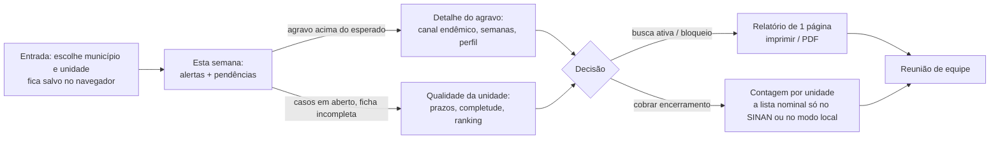

# Painel SES-RR × nosso painel: análise para gerentes de UBS

Data: 17/11/2026. Complementa `2026-11-analise-e-roadmap.md`; os itens N12, N13, N14 e N22 citados
aqui são os daquele documento.

**Público-alvo:** gerentes e coordenadores de Unidades Básicas de Saúde (UBS) de Roraima, que precisam
decidir ações no próprio território (busca ativa, bloqueio, remanejamento de equipe, cobrança de
encerramento de casos).

**Como o painel oficial foi lido.** A página <https://vigilancia.saude.rr.gov.br/pagina-monitora-sinan/>
é um site WordPress que só embute relatórios Power BI, então uma leitura simples da página não traz
nenhum dado. O Power BI foi aberto num navegador sem janela, com capturas de tela
(`capturas/ses-rr-*.png`). Foram vistas as duas páginas do painel **SINAN**, a capa de **Arboviroses**
e o painel de **Malária**. **Não foram abertos** os subpainéis de dengue, chikungunya, oropouche e zika
(atrás do botão "Acessar"), nem os de tuberculose e IST/AIDS. Também não foi testado se o Power BI
permite exportar. Nada abaixo sobre essas partes é afirmado.

## Resumo executivo

1. O painel da SES-RR é **estadual e descritivo**. Ele conta notificações por semana, sexo, raça e
   idade, filtra por município e agravo, e é atualizado todo dia ("Atualizado em 17/11/2026 03:12").
2. Para o gerente de UBS faltam quatro coisas: **recorte por unidade**, **taxas e limiares** (saber o
   que está acima do esperado), **indicadores de qualidade da notificação** e uma **lista do que fazer**.
3. Nosso painel já tem taxas de incidência, separação entre confirmados e notificados, textos em
   linguagem simples e mapa. As fraquezas são **dados atrasados** (o FTP do DATASUS sai bem depois da
   base estadual) e **nenhum uso do campo da unidade notificadora** (`ID_UNIDADE`, que já está nos
   nossos Parquet).
4. Há ganho rápido sem nenhuma base nova: indicadores de qualidade por unidade (prazos e completude de
   campos) e **casos em aberto há mais de 60 dias**, todos calculáveis com campos que já temos.
5. O território adscrito real, a lista nominal de pendências e dados em dia dependem de **base estadual
   identificada, e-SUS APS e CNES, com aval do encarregado de dados**. Isso fica fora do modo publicado.

## 1. Diagnóstico do painel atual

**O que existe** (só o que foi visto):

| Painel | Filtros | Visualizações | Observações |
|---|---|---|---|
| SINAN (2010–2026) | Ano (vários anos com CTRL), Município de notificação, Município de residência, Agravo/Doença | Barras de notificações por semana epidemiológica com total (18.562 em 2026); linha por semana para comparar anos; rosca por sexo; barras por raça; pirâmide etária; barras de Classificação final, Critério e Evolução | **49 agravos**, em maiúsculas e com erro de acentuação ("DOENÃA AGUDA PELO V═RUS ZIKA"). A lista mistura agravos de notificação com diagnósticos sindrômicos de IST (candidíase, tricomoníase). Dengue, chikungunya e malária não estão nela. O filtro de município inclui cidades de fora de RR (Manaus, Cuiabá, Maceió…). A página 2 tem duas tabelas soltas "ano / NU_ANO" (2001–2020, total 430.816), que parecem sobra de desenvolvimento |
| Arboviroses (2015–2026) | — | Capa com 4 botões: dengue (com "diagrama de controle"), chikungunya, oropouche ("Novo!") e zika | Subpainéis não abertos |
| Malária (dados do SIVEP-Malária, não do SINAN) | Abas Município de notificação / **de infecção**; UF, município, ano/mês; botões Confirmados / Descartados / Notificados | Números grandes por espécie (vivax, falciparum, mista); ocupação (agricultura, garimpo…); raça (75,9% indígena); idade; escolaridade; semanas; linha do tempo; **mapa**; tabela por município | É o mais rico. Ter o local de infecção e a ocupação é muito bom para a ação no território |

**Avaliação do ponto de vista do gerente de UBS:**

| Pontos fortes | Pontos fracos |
|---|---|
| Atualização diária a partir da base estadual | **Não há recorte por unidade nem por território**. O menor nível é o município, e Boa Vista concentra quase tudo |
| Série longa e comparação entre anos | **Só contagens**, sem taxa e sem limiar: o gerente não sabe se 30 casos é muito |
| Separa município de notificação e de residência | Classificação final, critério e evolução aparecem como **códigos** ("1", "2", "(Blank)": 13.589), e uma nota manda consultar o dicionário |
| Malária com local de infecção e ocupação | **Nenhum indicador de qualidade**, apesar de o próprio portal ter uma página de PQA-VS |
| Visual limpo e consistente | As últimas semanas caem (179 casos na semana 43, quase nada na 44) **sem aviso de atraso de notificação**, o que dá falsa impressão de queda |
| | Não há alertas nem lista do que fazer. A pirâmide etária publica contagens pequenas (48, 80) sem supressão |

## 2. Comparação com o nosso projeto

| Funcionalidade | Painel SES-RR | Nosso projeto | Lacuna / oportunidade |
|---|---|---|---|
| Fonte e atraso | Base estadual, atualizada todo dia | FTP do DATASUS: arquivos preliminares, com semanas ou meses de atraso | **Maior desvantagem nossa.** Pedir à SES uma exportação agregada periódica |
| Agravos | 49 do SINAN + painéis próprios (arboviroses, malária, oropouche) | Catálogo do FTP: dengue, chikungunya, zika, TB, hanseníase, violência…; malária tem aviso de que vem do SIVEP | Oropouche e malária (SIVEP) não estão no FTP usado, até onde se sabe |
| Recorte | Município de notificação e de residência | Município de residência ou de notificação, várias UFs | **`ID_UNIDADE` existe nos nossos Parquet e não é usado** |
| Taxas | Não | Incidência por 100 mil e mapa colorido | Mantemos a vantagem |
| Confirmado × notificado | Só na malária | Sim, com regras por agravo | Mantemos |
| Linguagem | Códigos crus | Rótulos amigáveis ("Não informado") | Mantemos |
| Comparação entre anos | Curva por ano (CTRL) | Curva semanal por ano | Equivalente |
| Limiar / canal endêmico | Só no subpainel de dengue (não verificado) | Planejado (N12/N13), método aguarda a vigilância | Prioridade |
| Qualidade da notificação | Não | Não | **Oportunidade para os dois** |
| Casos em aberto | Não | Não | Dá para fazer com `DT_ENCERRA` e `CLASSI_FIN` |
| Aviso de atraso nas últimas semanas | Não | Não (N14 descartada; link para o InfoDengue) | Basta uma faixa "semanas incompletas" |
| Mapa | Só malária | Sim | Mantemos |
| Exportação | Não verificado | CSV e resumo por município (modo publicado) | — |
| Supressão de contagens pequenas | Não | **Não** | Obrigatória antes de qualquer recorte por unidade |
| Funciona sem internet | Não | Sim (modo local) | Útil em municípios com internet ruim |

## 3. O que adicionar, manter e remover

| Ação | Item | Justificativa |
|---|---|---|
| **Adicionar** | Recorte por **unidade notificadora** (`ID_UNIDADE`) com o nome da unidade | É o único recorte abaixo do município que os dados públicos trazem. **Depende do CNES** para o nome. Limitação: é onde o caso foi notificado, não onde a pessoa mora (o hospital notifica muito) |
| Adicionar (só modo local, depois do aval do encarregado de dados) | Território adscrito de verdade | Precisa de endereço ou bairro (base estadual identificada) e da territorialização do **e-SUS APS**. Não cabe no modo publicado |
| **Adicionar** | Indicadores de qualidade por unidade (prazos e completude, tabela abaixo) | É o que o gerente controla diretamente e é cobrado no PQA-VS |
| **Adicionar** | "Casos em aberto há mais de 60 dias" por unidade (só contagem no modo publicado) | Vira cobrança concreta de encerramento |
| **Adicionar** | Painel "Exige atenção esta semana" | Responde em 5 segundos ao "e daí?" |
| **Adicionar** | Faixa cinza nas últimas 3–4 semanas: "dados ainda incompletos" | Evita ler atraso como queda (o erro visível no painel da SES) |
| **Adicionar** | Supressão: contagens de 1 a 4 aparecem como "< 5"; taxa só com 5 casos ou mais | Exigido pela LGPD; com recorte por unidade, células pequenas viram regra |
| **Adicionar** | Recortes de Roraima: raça indígena (`CS_RACA`), país de residência (`ID_PAIS`, migrantes), local provável de infecção (`COPAISINF`, `COMUNINF`), destaque para as cidades-gêmeas Pacaraima e Bonfim | Os campos existem. Aldeia, DSEI e área de difícil acesso **não estão no SINAN**: precisam do SIASI/SESAI ou de uma lista do IBGE ou da SES |
| **Adicionar** | Agravos prioritários: dengue, chikungunya, zika, TB, hanseníase, sífilis (adquirida, em gestante e congênita), violência | Todos estão no FTP. Violência só no nível do município, por ser sensível |
| Adicionar (outra base) | Oropouche, malária | **Dependem da base estadual ou do SIVEP-Malária**. Até lá, apontar para o painel da SES |
| **Manter** | Incidência, confirmados × notificados, rótulos amigáveis, mapa, modo local sem internet | São nossas vantagens sobre o painel da SES |
| **Manter** | Linha "como ler este número" em cada indicador | Público sem formação em estatística |
| **Remover / não copiar** | Códigos crus e tabelas de depuração (erros vistos no painel da SES) | Confundem o gestor |
| **Remover do caminho principal** | "Outras variáveis" como tela de entrada para o gerente | É útil para técnicos, mas para o gerente vira um menu sem fim. Deixar como tela avançada |
| **Não fazer** | Previsão por unidade (SARIMA, Prophet) e mapa de calor por endereço | Contagens pequenas demais por unidade, e não há coordenadas na base pública |

**Indicadores de qualidade (todos com campos que já temos):**

| Indicador | Cálculo | Em linguagem simples para o gestor |
|---|---|---|
| Notificação no prazo | % com `DT_NOTIFIC − DT_SIN_PRI` ≤ 7 dias | "Quantos casos foram avisados até uma semana depois dos primeiros sintomas" |
| Digitação no prazo | % com `DT_DIGITA − DT_NOTIFIC` ≤ 7 dias | "A ficha foi lançada no sistema em até uma semana?" |
| Investigação no prazo | % com `DT_INVEST − DT_NOTIFIC` ≤ 2 dias (agravos imediatos) | "A equipe foi atrás do caso a tempo?" |
| Encerramento no prazo | % com `DT_ENCERRA − DT_NOTIFIC` ≤ 60 dias | "O caso teve conclusão em até 60 dias?" |
| Em aberto há mais de 60 dias | `CLASSI_FIN` vazio e notificação com mais de 60 dias | "Casos esquecidos que precisam de conclusão" |
| Completude | % preenchido e diferente de "ignorado" em raça, escolaridade, ocupação, gestante (mulheres de 10 a 49 anos), data de sintomas | "Quanto da ficha foi preenchido de verdade" |
| Confirmação por exame | % com `CRITERIO` = laboratorial | "Quantos casos tiveram exame para confirmar" |

Os prazos de 7 e 60 dias são os usuais nos guias do Ministério e no PQA-VS. **A vigilância local
precisa validar os valores de cada agravo.**

## 4. Fluxo de uso proposto



**Tela principal (wireframe):**

```
┌──────────────────────────────────────────────────────────────────────┐
│ Município: [Boa Vista ▾]  Unidade: [UBS X ▾]  Semana: 44/2026         │
│ Dados até 02/11 · últimas 3 semanas ainda incompletas                 │
├──────────────────────────────────────────────────────────────────────┤
│ EXIGE ATENÇÃO ESTA SEMANA                                             │
│ ● Dengue: ACIMA do esperado há 2 semanas (14 casos; esperado até 9) → │
│ ● 12 casos em aberto há mais de 60 dias (8 de sífilis, 4 de TB)     → │
│ ○ Hanseníase: dentro do esperado                                      │
├──────────────────────┬───────────────────────┬───────────────────────┤
│ Casos na semana      │ Notificados no prazo  │ Fichas completas      │
│ 23  (▲ 35% vs 2025)  │ 71%  (meta 80%)       │ 64%  (raça: 52%)      │
├──────────────────────┴───────────────────────┴───────────────────────┤
│ Canal endêmico: dengue, residentes do município                       │
│ ▓▓ faixa esperada ── 2026 ░░ semanas incompletas                      │
├──────────────────────────────────────────────────────────────────────┤
│ Unidades do município (prazo e completude)     [Imprimir relatório]   │
│ UBS X   71% · 64% · 12 em aberto                                      │
│ UBS Y   88% · 81% · < 5 em aberto                                     │
└──────────────────────────────────────────────────────────────────────┘
```

Os números do wireframe são ilustrativos. O alerta usa a **residência no município** (com taxa). As
pendências e a qualidade usam a **unidade notificadora**, porque é ela que preenche a ficha.

## 5. Técnicas de análise de dados

| Objetivo gerencial | Técnica | Dados do SINAN | Visualização | Complexidade |
|---|---|---|---|---|
| "Estamos em surto?" | Canal endêmico por quartis (mediana e quartis de 5 a 7 anos, sem os anos epidêmicos), **no município** | `DT_SIN_PRI`/`SEM_PRI`, `ID_MN_RESI`, `CLASSI_FIN` | Faixas atrás da curva semanal | Baixa (N12; método aguarda a vigilância) |
| Alerta com poucos casos (unidade, agravo raro) | Limiar de Poisson (p < 0,05 sobre a média móvel) ou EARS C2 | Contagem semanal por `ID_UNIDADE` | Ponto vermelho na lista de alertas | Baixa |
| Não ler atraso como queda | Faixa "incompleto"; estimativa do atraso (nowcasting) só para arboviroses, via link do InfoDengue | `DT_SIN_PRI`, `DT_DIGITA` | Hachura nas últimas semanas | Baixa (faixa) / alta (nowcasting) |
| Previsão de curto prazo | SARIMA (statsmodels, licença BSD); Prophet (MIT) | Série semanal municipal com 5 anos ou mais | Cone de previsão | Média. **Só para Boa Vista e só arboviroses**: no resto as contagens são pequenas demais. Baixa prioridade |
| Comparar municípios pequenos | Taxa suavizada (bayesiana empírica) | Casos por município + população (**IBGE**) | Mapa colorido | Baixa a média |
| Aglomerados espaciais | Moran/LISA ou varredura espaço-temporal | Município (só 15) ou coordenadas | Mapa | **Pouco útil com 15 municípios; Kernel não dá sem endereço** (não há coordenadas na base pública). O SaTScan é gratuito, mas não é software livre: não pode entrar no projeto |
| Priorizar unidades | Score de qualidade: média ponderada dos 5 indicadores de qualidade, padronizada de 0 a 100 | `DT_*`, campos de completude, `ID_UNIDADE` | Ranking e semáforo | Baixa |
| Perfil das unidades | Agrupamento (k-means ou hierárquico) por mistura de agravos, idade e qualidade | Agregados por `ID_UNIDADE` | Grupos com descrição em texto | Média; pouco valor para a decisão. Fase 3 |
| Fronteira e migração | Proporção de casos com `ID_PAIS` ≠ Brasil ou infecção no exterior | `ID_PAIS`, `COPAISINF`, `TPAUTOCTO` | Barra empilhada por município | Baixa |
| Saúde indígena | Proporção e taxa entre indígenas | `CS_RACA` (o denominador depende do **IBGE/SESAI**) | Barra e tabela | Baixa (proporção) / média (taxa) |

A população adscrita de cada UBS, necessária para calcular taxas por unidade, vem do **e-SUS
APS/SISAB**. Sem ela, por unidade só dá para mostrar contagens e porcentagens.

## 6. Roadmap priorizado

| | **Esforço baixo** | **Esforço médio/alto** |
|---|---|---|
| **Impacto alto** | Faixa de semanas incompletas · supressão < 5 · qualidade por unidade · casos em aberto há mais de 60 dias · canal endêmico municipal (N12) | Tela "Esta semana" com alertas (N13) · nome das unidades via CNES · exportação agregada da SES |
| **Impacto médio** | Recortes indígena, migrante e de fronteira · relatório imprimível (N22) · taxa suavizada | Score de qualidade com metas · agravos de outras bases (oropouche, SIVEP) |
| **Impacto baixo** | — | Previsão SARIMA/Prophet · agrupamento de unidades · LISA/varredura |

- **Fase 1 (rápido, 2 a 4 semanas):** supressão de contagens pequenas (pré-requisito de tudo que
  recorta por unidade), faixa de semanas incompletas, indicadores de qualidade e casos em aberto por
  unidade notificadora (mostrando o código CNES), recortes indígena, migrante e de fronteira.
- **Fase 2 (médio prazo):** canal endêmico e nível de alerta municipal (N12/N13, depois da resposta da
  vigilância), tela "Esta semana", nomes das unidades via CNES, relatório de uma página (N22), taxa
  suavizada.
- **Fase 3 (avançado, com outras bases):** território adscrito e população da UBS (e-SUS APS), lista
  nominal de pendências só no modo local com aval do encarregado de dados, oropouche e malária,
  previsão para Boa Vista, agrupamento de unidades.

## Pontos em aberto

- Subpainéis de dengue, oropouche, tuberculose e IST/AIDS da SES não foram analisados.
- Não foi confirmado se oropouche já está no FTP do DATASUS.
- A defasagem dos arquivos do DATASUS em relação à base estadual é o maior risco de o gerente preferir
  o painel da SES; vale medir esse atraso e conversar com a SES sobre uma exportação agregada.
